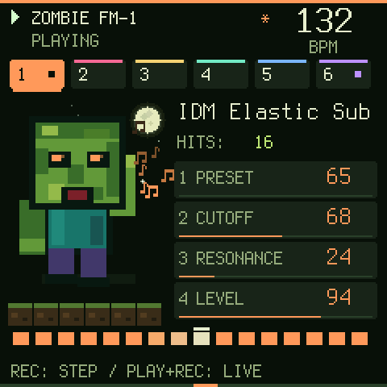
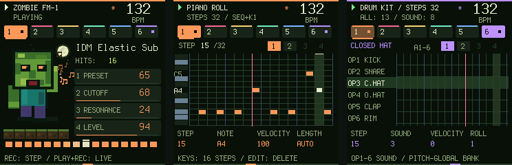
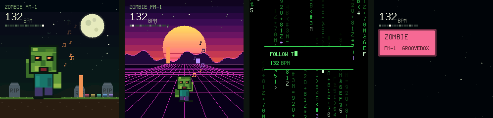
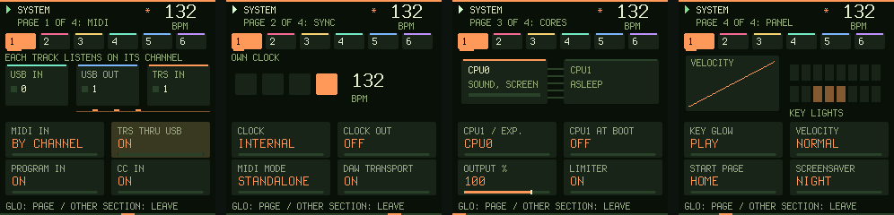
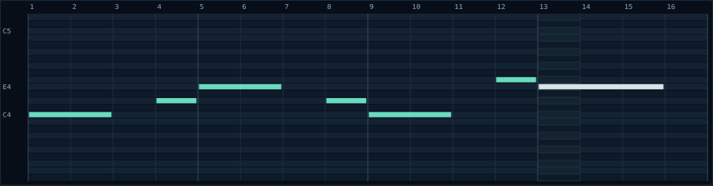
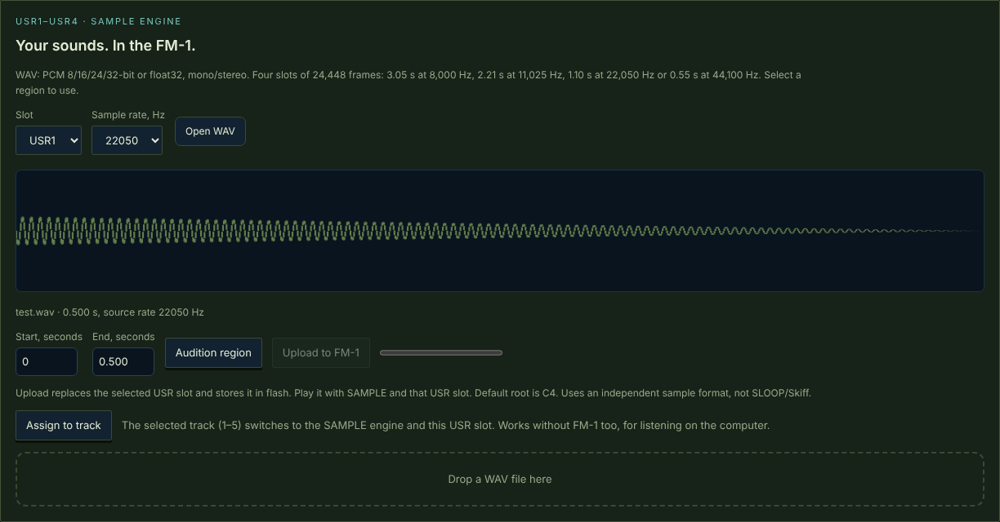

<div align="center">

**English** · [Русский](README.ru.md)

# 🧟 Zombie Groovebox for the M-VAVE FM-1

**An alternative firmware: six tracks, 128 presets, a drum machine, your own samples and a screen that moves with the music.**



[**Install from the browser**](https://joolo09.github.io/zombie-fm1-web/) ·
[Emulator](https://joolo09.github.io/zombie-fm1-web/emulator/) ·
[Web editor](https://joolo09.github.io/zombie-fm1-web/webapp/groovebox-180/) ·
[ZMB sounds](https://joolo09.github.io/zombie-fm1-web/emulator/sounds/zmb/)

</div>

---

## Features

| | |
|---|---|
| 🎛 **Sound** | 5 synth tracks + a drum kit. 8 engines: analog, FM, phase, wavetable, noise, percussion and **SAMPLE** (your WAVs). Filter, envelope, LFO, drive, delay, reverb, arpeggiator. |
| 🎹 **128 presets** | Factory, **IDM** and **ZMB** banks: 808s, wobble basses, supersaws, synthwave, horror atmospheres. |
| 🎼 **Sequencer** | Up to 64 steps per track, chords, scale and root, edit a held step with the knobs, Euclid and beat generator, 8-step undo. |
| 🥁 **Drum machine** | 16 sounds; chance, velocity and roll on every step; its own loop length for every sound. |
| ⏺ **Recording** | Count-in and a live overdub loop, step entry. |
| 🔌 **MIDI** | USB MIDI in and out, MIDI clock out, DAW modes, omni input, TRS → USB. |
| 🌙 **Living screen** | The zombie moves to the beat, notes fly off as sparks, 4 screensavers, an About screen. |

## Screen



Home, piano roll and drum grid. These are real firmware frames, captured in the simulator that runs the same C code.

## Screensavers



After a minute untouched the screen turns into **Night**, **Synthwave**, **Matrix** or **Bounce**, all moving with the music.

- On a screensaver, **hold HOME** for the next one.
- Any button wakes the screen and still does its job.
- Pick or switch off: GLO → page 5 → K4.

## SYSTEM tab



**GLO three times quickly** opens it:

- **MIDI:** by channel or omni, TRS → USB, program change and CC in;
- **Sync:** clock source and clock out;
- **Cores:** the second core (CPU1);
- **Panel:** key lights and the velocity curve.

## Web editor

Everything works from a computer over USB in Chrome or Edge, with nothing to install. Without an FM-1 the editor plays as a synth right in the browser.



**Mouse piano roll:**

- click to place a note;
- drag right to set its length;
- right-click to delete;
- Shift to add a note to the chord.



**Your own samples:**

1. Drop a WAV on the page.
2. Trim it and listen.
3. Send it to slot USR1–USR4.

Tracks 1–5 play it by note.

## Key controls

| Action | How |
|---|---|
| Track / tempo | **ALGO** / **SELECT** |
| Place steps | **SEQ**, then the 16 white keys |
| Step count | hold **SEQ**, turn **K1** |
| Edit a step | hold the step, turn **K1–K4** |
| Live recording | **REC** from home: count-in, then a recording loop |
| Undo / redo | **EDIT + OCT−** / **EDIT + OCT+** |
| Save the project | **SAVE** |
| About | **HOME** twice |
| SYSTEM tab | **GLO** three times quickly |
| Language | **HOME + GLO** |

## Install

1. Open the [site](https://joolo09.github.io/zombie-fm1-web/) in **Chrome** or **Edge** on a computer.
2. Connect the FM-1 with a USB **data** cable.
3. Click Find FM-1, then Install. Keep the tab open while it writes.

**Before installing:** save your projects with Export JSON in the editor.

**If writing stopped and the FM-1 screen is black:** the FM-1 is not broken, it is waiting in loader mode. Reload the page and install again.

> The firmware is tested in the emulator, which runs the same C code, and by the automated test suite. Releases are not tried on a physical FM-1 before publishing, so try a new version in the [emulator](https://joolo09.github.io/zombie-fm1-web/emulator/) first.

## For developers

```bash
python -X utf8 source/build-groovebox-180.py                     # firmware .fwsc, simulator, WASM
python -X utf8 tests/run_groovebox_audit.py --build --fuzz 200   # every check + panel fuzzing under ASan/UBSan
```

- Firmware code: `source/editions/shared/`.
- FM-1 platform: `source/platform-081/`.
- Building needs the JieLi toolchain (`JIELI_TOOLCHAIN`), the AC79 SDK (`AC79_SDK`) and `zig`.
- Release notes (in Russian): `source/GROOVEBOX-*-RU.md`.

## License

- App, DSP, interface and profiles: **MIT**.
- Platform: **MPL-2.0**.

Details in [`licenses/THIRD-PARTY.txt`](licenses/THIRD-PARTY.txt).
