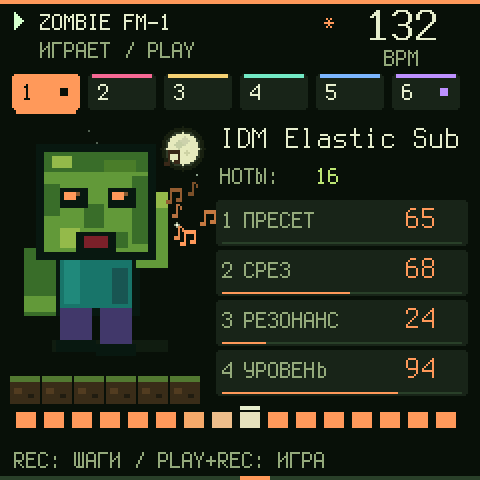
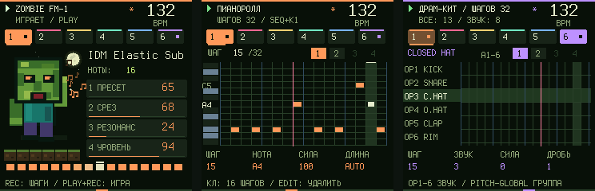
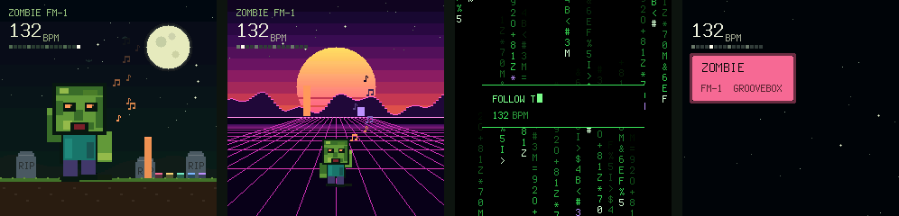
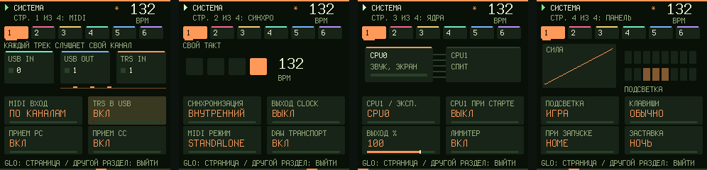
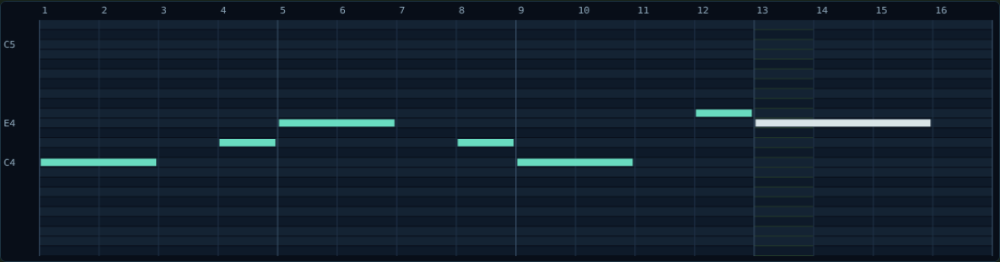
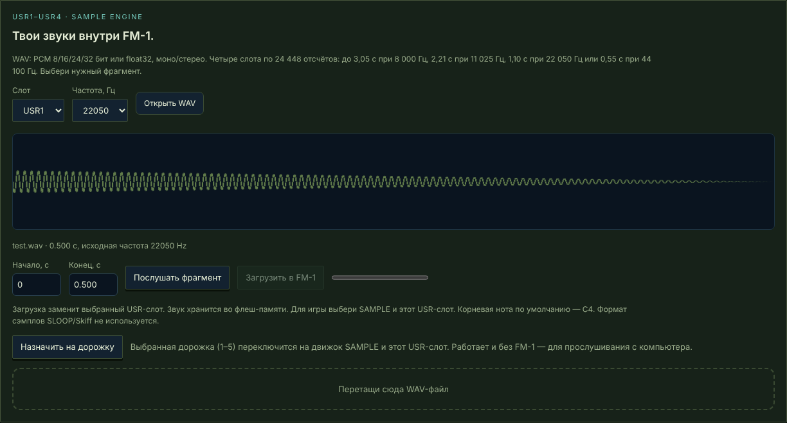

<div align="center">

[English](README.md) · **Русский**

# 🧟 Zombie Groovebox для M-VAVE FM-1

**Альтернативная прошивка: шесть дорожек, 128 пресетов, драм-машина, свои сэмплы и экран, который живёт вместе с музыкой.**



[**Установить из браузера**](https://joolo09.github.io/zombie-fm1-web/) ·
[Эмулятор](https://joolo09.github.io/zombie-fm1-web/emulator/) ·
[Веб-редактор](https://joolo09.github.io/zombie-fm1-web/webapp/groovebox-180/) ·
[Звуки ZMB](https://joolo09.github.io/zombie-fm1-web/emulator/sounds/zmb/)

</div>

---

## Возможности

| | |
|---|---|
| 🎛 **Звук** | 5 синтезаторных дорожек + драм-кит. 8 движков: аналог, FM, фазовый, wavetable, шум, ударные и **SAMPLE** (твои WAV). Фильтр, огибающая, LFO, drive, delay, reverb, арпеджиатор. |
| 🎹 **128 пресетов** | Заводской банк, **IDM** и **ZMB**: 808, вобл-басы, суперсо, синтвейв, хоррор-атмосферы. |
| 🎼 **Секвенсор** | До 64 шагов на дорожку, аккорды, лад и тоника, правка зажатого шага ручками, Эвклид и генератор ритма, отмена на 8 шагов. |
| 🥁 **Драм-машина** | 16 звуков, у каждого шага шанс, сила и дробь, у каждого звука своя длина петли. |
| ⏺ **Запись** | Отсчёт и живая запись по кругу с наложением, пошаговый ввод. |
| 🔌 **MIDI** | USB MIDI вход и выход, MIDI clock наружу, режимы DAW, омни-вход, TRS → USB. |
| 🌙 **Живой экран** | Зомби в такт, ноты-искры, 4 заставки, экран «О системе». |

## Экран



Главная, пианоролл и драм-сетка. Это настоящие кадры прошивки, снятые в симуляторе на том же C-коде.

## Заставки



Через минуту без касаний включается заставка: **Ночь**, **Синтвейв**, **Матрица** или **Лого**. Все двигаются под музыку.

- На заставке **держи HOME**, чтобы включить следующую.
- Любая кнопка будит экран и срабатывает как обычно.
- Выбрать или выключить: GLO → страница 5 → K4.

## Вкладка «Система»



**GLO три раза быстро**: MIDI (по каналам или омни, TRS → USB, приём Program Change и CC), синхронизация, второе ядро CPU1, подсветка и кривая силы нажатия.

## Веб-редактор

Всё можно делать с компьютера по USB, в Chrome или Edge, без установки программ. Без FM-1 редактор работает как синтезатор прямо в браузере.



**Пианоролл мышью:** клик ставит ноту, протягивание задаёт длину, правый клик удаляет, Shift добавляет в аккорд.



**Свои сэмплы:** перетащи WAV, обрежь, послушай и отправь в слот USR1–USR4. Дорожки 1–5 играют его по нотам.

## Главное управление

| Действие | Как |
|---|---|
| Выбрать дорожку / темп | **ALGO** / **SELECT** |
| Поставить шаги | **SEQ**, затем 16 белых клавиш |
| Число шагов | держи **SEQ**, крути **K1** |
| Правка шага | зажми шаг и крути **K1–K4** |
| Живая запись | **REC** с главной: отсчёт, потом запись по кругу |
| Отмена / повтор | **EDIT + OCT−** / **EDIT + OCT+** |
| Сохранить проект | **SAVE** |
| «О системе» | **HOME** дважды |
| Вкладка «Система» | **GLO** три раза быстро |
| Язык | **HOME + GLO** |

## Установка

1. Открой [сайт](https://joolo09.github.io/zombie-fm1-web/) в **Chrome** или **Edge** на компьютере.
2. Подключи FM-1 USB-кабелем **с передачей данных**.
3. Нажми «Найти FM-1» и «Установить». Не закрывай вкладку, пока идёт запись.

Перед установкой сохрани проекты: «Экспорт JSON» в редакторе. Если запись прервалась, а экран FM-1 чёрный, FM-1 не сломан: он ждёт в режиме загрузчика. Обнови страницу и установи снова.

> Прошивка проверяется в эмуляторе на том же C-коде и автотестами. На физическом FM-1 версии перед публикацией не проверяются: сначала попробуй новую версию в [эмуляторе](https://joolo09.github.io/zombie-fm1-web/emulator/).

## Для разработчиков

```bash
python -X utf8 source/build-groovebox-180.py                     # прошивка .fwsc, симулятор, WASM
python -X utf8 tests/run_groovebox_audit.py --build --fuzz 200   # все проверки + фаззинг под ASan/UBSan
```

- Код прошивки: `source/editions/shared/`. Платформа FM-1: `source/platform-081/`.
- Для сборки нужны тулчейн JieLi (`JIELI_TOOLCHAIN`), AC79 SDK (`AC79_SDK`) и `zig`.
- Изменения по версиям: `source/GROOVEBOX-*-RU.md`.

## Лицензия

Приложение, DSP, интерфейс и профили распространяются по **MIT**, платформа по **MPL-2.0**. Подробности в [`licenses/THIRD-PARTY.txt`](licenses/THIRD-PARTY.txt).
