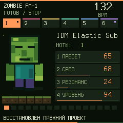
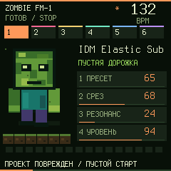

# Groovebox 0.13.6 beta — согласованное сохранение музыки

## Что исправлено

Ранее мелодии и драмка сохранялись отдельными журналами. Каждый был защищён от оборванной записи, но сбой между двумя журналами мог загрузить новые мелодии со старой драмкой. Тест воспроизводит это на настоящем коде NOR-хранилища.

Теперь музыка сохраняется в неактивный банк, оба компонента перечитываются и сверяются, затем записывается небольшой общий commit. Пока commit не готов, активен прежний целый проект. Перед записью приложение останавливает звук и ставит признак занятости под короткой блокировкой прерываний; сами операции флеш выполняются вне этой блокировки. Ошибка SAVE не помечает музыку сохранённой. После сбоя можно повторить сохранение.

Если повреждён активный компонент, проверяется предыдущая целая пара. Если ни одна пара не сохранилась, прошивка начинает пустой проект, показывает сообщение о повреждении и признак несохранённого состояния. Удалённая драмка не восстанавливается из несогласованного старого файла.

## Совместимость

- Старые проекты читаются; переход к парному хранению происходит при SAVE, а не при загрузке.
- Формат JSON, пресеты и управление не изменены. Системные настройки, калибровка, Bluetooth и пользовательское PCM имеют прежние области; системные предпочтения сохраняются отдельно от музыки.
- Дополнительные банки и commit занимают ранее свободные 0x99000–0x9EFFF. Проверка карты подтверждает отсутствие пересечений с PCM, калибровкой, Bluetooth и областью загрузчика.
- **Перед откатом на 0.13.5 экспортируй проект JSON в редакторе 0.13.6.** Старая прошивка не понимает общий commit и может увидеть более старый банк. После отката проект можно импортировать в редактор 0.13.5.
- Версия установщика по умолчанию остаётся 0.8.3. Старые сборки сохранены. Самплер и Lab не публиковались заново.

## Проверки

315 точек обрыва/частичного стирания и программирования на реальном коде NOR-журнала: первая миграция, оба банка, повтор после ошибки. Проверены повреждение CRC компонентов, потеря commit-записей, тихий отказ программирования и восстановление предыдущей пары.

15 сценариев полного C-приложения: SAVE, перезапуск без записи во флеш, ошибки каждого этапа сохранения, физическая кнопка SAVE, повтор, CRC-восстановление, пустой старт при утрате обеих копий и загрузка старого проекта.

[Полная матрица программных проверок](GROOVEBOX-AUDIT-136-RU.md) · [машинный отчёт](../emulator/audit.json).

Физический FM-1 не прошивался. Программные проверки не подтверждают реальные датчики, USB, время записи/задержку звука и фактическое отключение питания устройства.

## Экраны C-эмулятора

