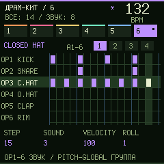

# Groovebox 0.13.7 beta — OP-кнопки и ввод драмки с клавиш

Выбери шестую дорожку и нажми SEQ. Выключи REC для расстановки шагов.

## Выбор инструмента без регуляторов

- **OP1–OP6** выбирают один из шести звуков, показанных строками на экране. Выбор сам не записывает удар. При одновременном нажатии OP и белого шага сначала выбирается звук.
- **PITCH** — предыдущая группа звуков; **GLOBAL** — следующая. Группы: A (1–6), B (7–12), C (13–16). В группе C OP5/OP6 не назначены и ничего не изменяют.
- **MONO/POLY** — отмена/повтор последнего изменения.

Подписи OP1–OP6/PITCH/GLOBAL/MONO/POLY сверены с [официальной панелью M-VAVE](https://open.m-vave.com/fm1-workbench). В эмуляторе они показаны своими именами. Пять мелодических дорожек сохраняют прежнее управление.

| Группа | OP1 | OP2 | OP3 | OP4 | OP5 | OP6 |
|---|---|---|---|---|---|---|
| A | Kick | Snare | Closed Hat | Open Hat | Clap | Rim |
| B | Low Tom | Mid Tom | High Tom | Crash | Ride | Cowbell |
| C | Tambourine | Shaker | Claves | Wood | — | — |

## Расстановка и удаление

- **Белые 1–16** включают/выключают шаг выбранного барабана. Повторное нажатие действительно удаляет удар.
- **EDIT + белая** стирает именно этот шаг выбранного звука. Пустой шаг остаётся пустым.
- **Короткий EDIT** удаляет выбранный удар в текущем шаге. Крайняя правая верхняя клавиша без OP-подписи также удаляет его при выключенном REC.
- **PRESET** или SEQ + OCT−/+ выбирают банк шагов 1–16, 17–32, 33–48, 49–64. Выбор инструмента при этом сохраняется.
- **SEQ + REC** очищает партию выбранного барабана. **SEQ + крайняя правая верхняя клавиша** очищает весь драм-трек. EDIT + OCT−/+ по-прежнему дают отмену/повтор.

Пример: в группе A нажми OP1 и белые 1/5/9/13; OP2 и белые 5/13; OP3 и белые через одну. Для удаления снова нажми нужную белую или EDIT + белую. Другие барабаны на том же шаге не стираются.

На STOP белые светятся у включённых шагов выбранного звука. Удалённый шаг гаснет после отпускания клавиши. Выбранный OP подсвечен. Во время PLAY бегунок мигает поверх шагов.

## Игра и запись

С REC белые играют 16 разных пэдов. Без PLAY — пошаговая запись, с PLAY — запись в ритм. OP-кнопки остаются выбором инструмента для просмотра/правки. Крайняя правая верхняя клавиша вводит паузу и переводит к следующему шагу, сохраняя REC.

EDIT + белая завершает REC и стирает указанный шаг. Отпускание ранее зажатого пэда после этого не меняет курсор. Смена OP во время зажатого пошагового удара не подменяет длину записываемой партии длиной другого барабана.

На HOME белые играют пэды как прежде. Управление мелодиями, включая EDIT + ноты аккорда, не изменено.

## Эмулятор и проверки

На ПК A S D F G H J K L ; ' \ Z X C V — белые. В драм-секвенсоре цифры 1–6 — OP1–OP6, 7/8 — PITCH/GLOBAL, 9/0 — MONO/POLY, + — удалить/пауза. Кнопка «Стереть шаги · EDIT» удерживает EDIT.

`tests/test_drum_key_workflow.mjs` проверяет все 16 звуков, 64 шага, выбор OP, совместные нажатия, EDIT, отмену/повтор, подсветку, REC, SAVE/перезапуск и сохранение управления мелодиями. Полный прогон: `python -X utf8 tests/run_groovebox_audit.py --build`.

Согласованное хранение 0.13.6 сохранено; JSON не изменён. Перед откатом на 0.13.5 экспортируй JSON. [Границы аппаратной проверки](GROOVEBOX-AUDIT-136-RU.md). Эта версия проверена в C-эмуляторе; физический FM-1 ещё не проверен.

## Экран драм-секвенсора

