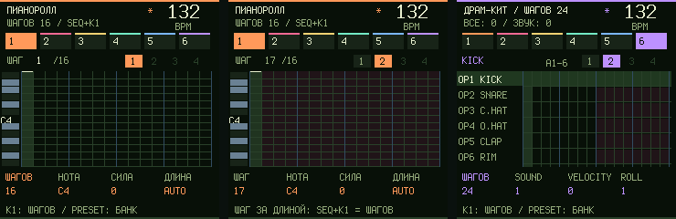

# Groovebox 0.15.0 beta: число шагов дорожек и драмки

## Как задать число шагов

**Удерживайте SEQ и крутите K1.** Это число шагов выбранной дорожки, от 1 до 64. На шестой дорожке K1 задаёт одну общую длину сразу для всех 16 барабанов.

- Пока SEQ удерживается, внизу экрана в первой ячейке видно «ШАГОВ» и текущее значение. Курсор шага при этом не двигается.
- Быстрые значения: удерживайте REC, нажмите HOME (слой фиксируется), затем белую 7, 8 или 9 для 16, 32 или 64 шагов. K4 в этом слое тоже задаёт «ШАГОВ». На драмке оба способа меняют длину всего кита.
- Отмена и повтор: EDIT + OCT− / OCT+. Смена длины драмки отменяется одним шагом.
- Число шагов сохраняется кнопкой SAVE вместе с проектом и не теряется после перезапуска.

## Что показывает экран

- В заголовке пианоролла: «ШАГОВ 32 / SEQ+K1». В строке шага: «ШАГ 5 /32».
- В заголовке драмки: «ДРАМ-КИТ / ШАГОВ 32». Если у звуков разные длины, вместо числа написано «РАЗНО».
- Шаги после конца цикла закрашены тёмно-красным, неиспользуемые банки 1–4 приглушены.
- Если курсор стоит за концом цикла, внизу подсказка: «ШАГ ЗА ДЛИНОЙ: SEQ+K1 = ШАГОВ». Такой шаг можно поставить заранее: он зазвучит, когда цикл станет длиннее.

## Отдельная длина звука драмки

Длину одного звука можно по-прежнему задать отдельно (полиритм): SEQ → страница 2 → K3 «LENGTH», или страница ENV → 2 → «ДЛИНА ЗВУКА». Если после этого повернуть SEQ+K1, все звуки получат общую длину: она отсчитывается от длины выбранного звука.

## Изменения

- Новое: общая длина драм-кита. В движке это `z_dm_length()` и `z_dm_common_length()`.
- LEN 16/32/64 и K4 в слое REC на драмке теперь меняют весь кит, а не только выбранный звук.
- «ДЛИНА» дорожки на русских страницах переименована в «ШАГОВ».
- Формат проекта не изменился, проекты 0.13.6–0.14.0 открываются как есть.
- Звук 0.14.0 (без щелчков, лимитер) сохранён.

## Проверки

`python -X utf8 tests/run_groovebox_audit.py --build`: 35 проверок. Новая — `tests/test_step_length.mjs`: SEQ+K1 на синте и драмке, границы 1 и 64, отмена и повтор, объединение разных длин, тайлы LEN, 16-шаговый цикл всех звуков при воспроизведении, сохранение после SAVE и перезапуска. Физический FM-1 не прошивался.
