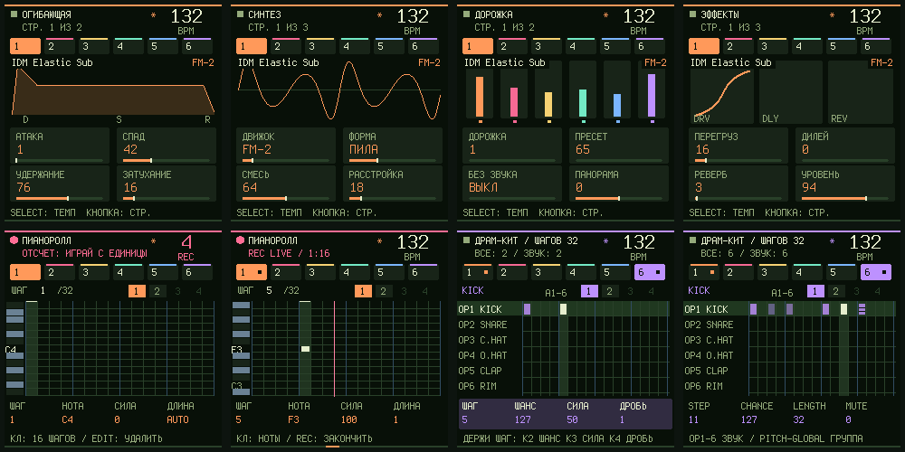

# Groovebox 0.16.0 beta: запись и драмка по образцу Felucca, новый экран

Управление записью и драм-сеткой переделано по образцу [Felucca 1.7.0](https://github.com/hugelton/Felucca), тоже прошивки для FM-1. Взяты идеи, код Felucca не копировался: Felucca под GPL-3.0, Zombie под MIT. Звук, формат проектов и остальное управление 0.15.1 не изменились.

## Запись

| Что нажать | Что происходит |
|---|---|
| **REC** на любой странице, кроме SEQ (при стопе) | Отсчёт: в шапке крупная красная цифра 4, 3, 2, 1, щёлкает метроном. Потом петля сама запускается и пишет с наложением, метроном щёлкает дальше. |
| **REC** на странице SEQ (при стопе) | Пошаговая запись в позицию курсора, как раньше, для мелодий и драмки. |
| **REC** во время игры | Сразу живая запись с наложением, без отсчёта. |
| **REC** ещё раз | Конец дубля. Петля продолжает играть. |
| **REC** во время отсчёта | Отмена: ничего не играет и не пишется. |
| **PLAY** во время отсчёта | Старт сразу, без остатка отсчёта. |
| **Слой REC** (удерживай REC, нажми HOME) | Белая 5 — CLICK (метроном всегда), 6 — REC CLICK (метроном при записи), 14 — COUNT-IN (выкл / 1 / 2 такта), 15 — CLEAR (очистить дорожку, отменяется EDIT + OCT−). K3 — ОТСЧЕТ. |

Отсчёт и клик при записи хранятся в системных настройках и сохраняются кнопкой SAVE. По умолчанию отсчёт длится 1 такт, клик включён.

Исправлено: раньше REC + HOME (открыть слой REC) переключал страницу на SEQ, а при следующем открытии включал запись. Теперь нажатие REC, которое использовано для открытия слоя, ничего не меняет.

## Драм-сетка

- **Короткое нажатие шага** включает или выключает удар. Срабатывает при отпускании, а в момент нажатия сразу звучит выбранный барабан.
- **Зажми шаг и крути K2, K3 или K4**: меняются вероятность, сила и дробь этого шага. Так работает на любой странице SEQ, при отпускании удар остаётся. Если шаг был пустой, он создаётся. Пока шаг зажат, на экране панель «ШАГ / ШАНС / СИЛА / ДРОБЬ», внизу подсказка. Отменяется одним действием EDIT + OCT−.
- **Сила удара видна яркостью** ячейки, дробь показана делением ячейки на части.
- **Доли подсвечены:** белые клавиши шагов 1, 5, 9, 13 слабо светятся в пределах длины цикла, на драмке и на пианоролле. Работает при подсветке клавиш «ИГРА», это значение по умолчанию.

## Сохранение

**SAVE во время игры** больше не останавливает музыку. В шапке появляется «SAVE: ПОСЛЕ STOP», и проект сохраняется сразу после остановки.

## Экран

- Значок транспорта в шапке: ■ стоп, ▶ игра (зелёный), ● запись или отсчёт (красный).
- Под шапкой номер страницы «СТР. 1 ИЗ 3» и состояние.
- На каждой странице параметров живая картинка того, что меняют ручки:
  - ENV — огибающая ADSR;
  - СИНТЕЗ — форма волны выбранного движка (аналог с расстройкой, FM-2, фазовый, wavetable, шум, ударные);
  - LFO — бегущая волна;
  - СРЕЗ / РЕЗОНАНС — АЧХ фильтра со всплеском;
  - ДОРОЖКА — микшер из шести дорожек (уровень, панорама, M/S);
  - ЭФФЕКТЫ — кривая перегруза, эхо и хвост реверба;
  - НАСТРОЙКИ — сетка свинга;
  - АРПЕДЖИАТОР — рисунок режима.
- Скруглённые карточки с полосой значения. Номера дорожек подсвечиваются, когда дорожка звучит.

## Проверки

- `tests/test_recording_160.mjs` (10 проверок): отсчёт и запуск, отмена, PLAY во время отсчёта, SEQ — пошаговая запись, наложение во время игры, драмка, настройка отсчёта сохраняется после перезапуска, 2 такта, REC + HOME без побочных эффектов, SAVE во время игры.
- `tests/test_drums_160.mjs` (7 проверок): переключение при отпускании, звук при нажатии, сила и дробь зажатого шага, создание удара, отмена, доли и их граница по длине цикла.
- Около 30 старых проверок, которые запускали пошаговую запись кнопкой REC с главной страницы, теперь сначала открывают SEQ (`e.rec()`). Что они проверяют, не изменилось.
- `python -X utf8 tests/run_groovebox_audit.py --build --fuzz 150`: 39 из 39, включая 150 сессий фаззинга под ASan/UBSan. Образ 238 612 Б, RAM 65 512 из 98 304 Б.
- Платформа: добавлен `plat_leds_dim()` (приглушённые клавиши) для устройства, симулятора и браузера.

Физический FM-1 не прошивался. Сначала попробуйте 0.16 в [эмуляторе](../emulator/): он работает на этом же коде.
