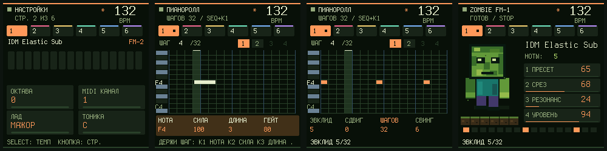

# Groovebox 0.17.0 beta: лад, правка шагов, SEQ-инструменты, MIDI clock

Продолжение 0.16: ещё несколько идей из [Felucca 1.7.0](https://github.com/hugelton/Felucca) (только идеи, код не копировался: Felucca под GPL-3.0, Zombie под MIT). Звук, формат проектов и всё управление 0.16 сохранены.

## Лад: играй только в тональность

**Настройки (GLO, страница 2): ЛАД и ТОНИКА.** Лады: мажор, минор, дорийский, фригийский, миксолидийский, пентатоника мажор/минор, блюз, гармонический минор.

- Клавиши FM-1 попадают в ноты лада: нота вне лада сдвигается к ближайшей, а при равном расстоянии вниз. Это работает и для живой записи, и для EDIT + клавиши, и для арпеджиатора.
- Ноты лада слабо подсвечены на клавишах (подсветка клавиш «ИГРА», это значение по умолчанию).
- Барабанная дорожка и входящий MIDI не меняются.
- Лад и тоника сохраняются в системных настройках (SAVE) и доступны в веб-редакторе.

## Зажми шаг мелодии

На странице SEQ нажми белую клавишу: пустой шаг создаётся, а пока клавиша зажата, ручки правят этот шаг:

| Ручка | Что меняет |
|---|---|
| K1 | нота (в ладу, если лад включён) |
| K2 | сила |
| K3 | длина (AUTO, 1–63 шагов) |
| K4 | гейт |

Вся правка зажатого шага отменяется одним действием (EDIT + OCT−). Так же устроена драм-сетка: K2 шанс, K3 сила, K4 дробь.

## SEQ-инструменты

Удерживай **SEQ** и крути **PRESET** до четвёртой страницы слоя. Ручки: K1 УДАРЫ, K2 СДВИГ, K3 ШАГОВ, K4 СВИНГ. Первые четыре чёрные клавиши:

| Чёрная | Инструмент | Что делает |
|---|---|---|
| 1 | **ЭВКЛИД** | Равномерно раскладывает K1 ударов по K3 шагам, со сдвигом K2. E(3,8) даёт x..x..x. Новые ноты берут высоту курсора. На барабанах правит выбранный звук. |
| 2 | **СЛУЧАЙНО** (на драмке БИТ) | Новый случайный рисунок. На драмке готовый бит для выбранного звука. |
| 3 | **ПОЛОВИНА** | Петля обрезается до первой половины. На драмке с общей длиной режется весь кит. |
| 4 | **COOK** | Две небольшие перемены: шаг включается или выключается, либо меняется акцент. Новые ноты берутся из самого паттерна, поэтому остаются в тональности. Нажимай, пока не понравится. |

Остальные чёрные клавиши на этой странице работают как раньше: размножить, сдвинуть, развернуть, стереть. Чтобы отменить инструмент, **отпусти SEQ** и нажми EDIT + OCT−.

## MIDI clock наружу

**Настройки (GLO, страница 5): ВЫХОД CLOCK.** По умолчанию выключен. Включённый, он отправляет по USB 24 импульса на четверть плюс Start и Stop. Импульсы идут вместе с шагами и тоже подчиняются темпу и свингу. Не отправляется при внешней синхронизации (иначе получился бы круг) и в режимах DAW.

## Отмена на 8 шагов

Отмена и повтор теперь хранят 8 состояний вместо 4 (и для мелодий, и для драмки). Это кольцевой буфер: при записи копируется только одно состояние, а не вся история.

## Веб-редактор

В «Настройки» → «Запись, лад и синхронизация»: отсчёт, метроном при записи, лад, тоника и MIDI clock. Читает и записывает настройки на FM-1 командой 29 (значения проверяет сама прошивка).

## Проверки

- Новые: `test_scale_170` (8), `test_melody_hold_170` (8), `test_clock_170` (9), `test_tools_170` (11), `test_history_170` (7), `test_editor_system_170` (7).
- Эвклид сверен с формулой для 8 комбинаций ударов, шагов и сдвига на мелодии и на драмке. Клок проверен по темпу: 48 импульсов в секунду при 120 BPM, равномерно, без пачек.
- `python -X utf8 tests/run_groovebox_audit.py --build --fuzz 200`: 45 проверок, включая 200 сессий фаззинга под ASan/UBSan. Инварианты фаззера расширены: ранги лада, биты настроек записи, ручки Эвклида, зажатая клавиша, отсчёт.
- Образ 243 072 Б, RAM 65 544 из 98 304 Б, пул 300 036 из 344 064 Б (большая отмена).

Физический FM-1 не прошивался. Сначала попробуйте в [эмуляторе](../emulator/).
