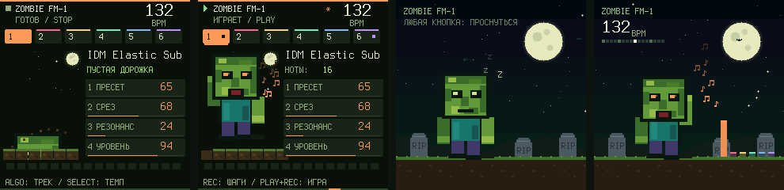

# Groovebox 0.18.0 beta: живой экран, ночная заставка, банк ZMB

Звук движка, формат проектов и всё управление 0.17 сохранены. Новое: 32 звука и экран, который двигается вместе с музыкой.

## Банк ZMB: 32 новых пресета

Слоты 97–128: крути PRESET дальше банка IDM. Теперь пресетов 128, весь диапазон Program Change. Послушать можно [на сайте](../emulator/sounds/zmb/), все записи отрендерены тем же C-движком, что работает в FM-1.

| Группа | Пресеты |
|---|---|
| Басы и 808 | 808 Grave, Grave Wobble, Rotten Reese, Acid Crawl, Sub Hunger, FM Growl, Phase Pump, Tomb Pluck Bass |
| Лиды | Supersaw Moon, Synthwave Lead, Chip Ghoul, Screamer, Hoover Horde, Laser Bite, Neon Brain, Moon Whistle |
| Клавиши и плаки | Lo-Fi Keys, Crypt Bells, Tomb Marimba, Rave Stab, Pluck Rain, Dusty Rhodes, Glass Coffin, House Organ |
| Хоррор и атмосферы | Graveyard Fog, Haunted Choir, Dead Radio, Siren Moan, Brain Drill, Coffin Knock, Ghost Swell, Undead Riser |

Каждый пресет проверен рендером: слышен, без NaN, без клиппинга, все 32 звучат по-разному. По средней громкости банк на уровне заводского (−32 дБ против −34).

## Живой главный экран

- **Зомби качает головой в такт** (по шагам секвенсора, не по таймеру), машет руками на восьмых, глаза светятся цветом выбранной дорожки.
- **Рот открывается под звук**: по уровню выхода и по нотам дорожек.
- **Ноты-искры**: каждая новая нота (клавиша, шаг, MIDI, удар драмки) вылетает цветным значком своей дорожки.
- **Луна, звёзды и летучая мышь** за спиной; при игре земля едет под ногами.
- **При включении** зомби вылезает из земли (1,8 с, только картинка: кнопки работают сразу).
- **Под номерами дорожек** индикаторы активности; значок PLAY вспыхивает на каждой доле.
- **Ручки**: карточка параметра вспыхивает цветом дорожки при повороте (на главной и на страницах параметров).
- **Шаги**: за курсором воспроизведения тянется затухающий след.

## Ночная заставка

Через минуту без касаний клавиш, кнопок и ручек включается полноэкранная ночная сцена: луна, мерцающие звёзды, летучие мыши, холмы и надгробия.

- **Стоп**: зомби спит, над ним «Z z z», белые клавиши медленно светятся волной (при подсветке клавиш «ИГРА»).
- **Игра**: зомби танцует, видны темп и позиция шага, шесть дорожек горят «свечами» в своих цветах.
- **Любое касание** будит экран *и выполняется как обычно*: нажатая клавиша играет ноту, ручка крутится.
- Не включается при записи, отсчёте, открытом слое, зажатом шаге, в режиме DAW и пока на экране сообщение.
- **Выключить**: Настройки (GLO), страница 5, ручка K4 «ЗАСТАВКА». Или в веб-редакторе: «Настройки» → «Запись, лад и синхронизация». Хранится в системных настройках (SAVE), бит 4 байта, который уже хранил настройки записи. Старые файлы настроек дают «вкл».

На этой странице раньше стоял второй дубль «ЯЗЫК» (он остался на первой странице настроек).

## Сайт

- В шапке два экрана FM-1 с настоящей анимацией прошивки (кадры сняты в симуляторе на том же C-коде).
- Звёздный фон, блоки плавно появляются при прокрутке, у кнопки «Установить» пульс, у полосы записи бегущие полосы.
- При «уменьшении движения» в системе все анимации отключаются.

## Проверки

- Новый `test_scene_180` (8 проверок): заставка появляется через минуту и не раньше; касание клавиши будит и играет ноту; поворот ручки будит и меняет значение; выключатель работает и читается редактором; не включается при записи; при игре музыка не прерывается; волна на клавишах; банк ZMB (32 пресета слышны, без клиппинга, различаются).
- Обновлены старые проверки под 128 пресетов (`idm-regressions`, `protocol-integrity`, фаззер выбирает пресеты 0–127) и под новый пункт настроек (`editor-system-170`).
- `python -X utf8 tests/run_groovebox_audit.py --build --fuzz 200`: все проверки, включая 200 сессий фаззинга под ASan/UBSan. Инвариант фаззера: биты настроек записи и заставки.
- Образ 249 316 Б (было 243 072), RAM 65 720 из 98 304 Б (+176 Б), пул без изменений. Анимация только рисует: не трогает звук, MIDI и сохранённые данные.

Физический FM-1 не прошивался. Сначала попробуйте в [эмуляторе](../emulator/).
