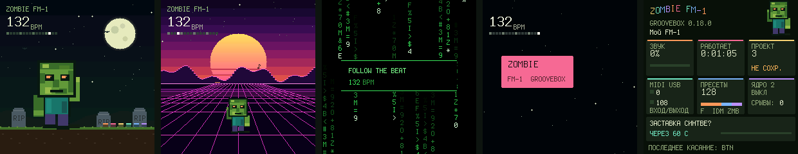

# Groovebox 0.18.1 beta: четыре заставки, «О системе», исправлена заставка

Всё из [0.18.0](GROOVEBOX-180-RU.md) (банк ZMB, живой экран) плюс:

## Исправлено: заставка не появлялась на FM-1

В эмуляторе заставка работала, а на устройстве не включалась. Вероятная причина: энкодер в покое иногда отдаёт одиночный щелчок ±1 (дребезг на границе фиксации). 0.18.0 считала каждый такой щелчок касанием и сбрасывала минутный таймер.

Теперь касанием считается только настоящий поворот: два щелчка за раз или второй щелчок в ту же сторону в течение 0,7 с. Сам щелчок по-прежнему меняет параметр, но таймер заставки не сбрасывает. Клавиши и кнопки сбрасывают таймер, как раньше.

Если заставка всё равно не появится, открой «О системе» (HOME дважды). Там видно, через сколько секунд она включится или что ей мешает, и что последним засчиталось как касание (KEY, BTN, K1…K4, SELECT, ALGO, PRESET).

## Четыре заставки

| | Заставка | Что на ней |
|---|---|---|
| 1 | **НОЧЬ** | Луна, летучие мыши, кладбище; при игре дорожки горят «свечами» |
| 2 | **СИНТВЕЙВ** | Закатное солнце с полосами, неоновые горы, сетка едет в темп; дорожки светятся на горизонте |
| 3 | **МАТРИЦА** | Зелёный «дождь» символов; при игре головы колонок вспыхивают цветами дорожек |
| 4 | **ЛОГО** | Табличка ZOMBIE отскакивает от краёв и меняет цвет; попадание в угол празднуется |

- **Сменить:** когда заставка на экране, держи **HOME**: каждые 0,6 с следующая, внизу подпись. Короткое нажатие HOME только будит экран и не переключает страницу.
- **Выбрать или выключить в настройках:** GLO, страница 5, K4 «ЗАСТАВКА»: ВЫКЛ, НОЧЬ, СИНТВЕЙВ, МАТРИЦА, ЛОГО. В веб-редакторе: «Настройки» → «Запись, лад и синхронизация».
- Выбор хранится в системных настройках, **SAVE** запоминает его.

## «О системе» (HOME дважды)

Живой экран вместо страницы текста:

- Название с волной цветных букв, версия, имя владельца, анимированный зомби.
- Карточки:
  - **ЗВУК:** нагрузка движка в % и уровень выхода;
  - **РАБОТАЕТ:** время с включения;
  - **ПРОЕКТ:** сколько нот, сохранён ли;
  - **MIDI USB:** вход и выход, мигают при обмене;
  - **ПРЕСЕТЫ:** 128, по банкам;
  - **ЯДРО 2:** состояние и срывы звука.
- Строка заставки: какая выбрана, через сколько включится (с полосой), или что мешает: выключена в настройках, открыт слой, идёт запись, зажат шаг, режим DAW, сообщение на экране.
- Закрывается любой клавишей или кнопкой. Сама она тоже работает: двойное нажатие HOME оставляет на главной странице.

Старый текстовый экран «Об устройстве» (держи HOME) остался как был.

## Проверки

- `test_scene_180`: 13 проверок. Добавлены пять:
  - одиночные щелчки ручки не мешают заставке;
  - настоящий поворот её будит;
  - удержание HOME меняет заставку и не будит, а короткое нажатие будит и не переключает страницу;
  - все четыре заставки рисуются по-разному;
  - двойное нажатие HOME открывает «О системе», а два медленных нажатия нет.
- Полный аудит со 200 сессиями фаззинга под ASan/UBSan.

Физический FM-1 не прошивался.
